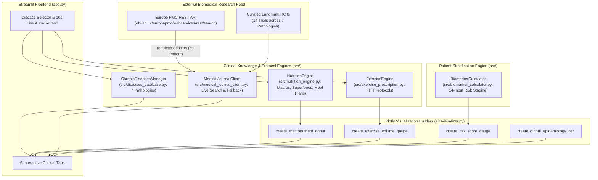

<h1 align="center">🩺 Clinical Chronic Disease Intelligence &amp; Medical Research Platform</h1>

<p align="center">
  <strong>Evidence-aligned chronic pathology, therapeutic nutrition, FITT exercise prescription, and medical literature intelligence platform built with Streamlit and Plotly — uniting clinical dossiers across 7 major non-communicable diseases with a multi-system biomarker risk calculator, landmark trial summaries, and live Europe PMC open-access clinical research indexing.</strong>
</p>

<p align="center">
  <a href="#-executive-overview--disease-coverage"><b>Overview &amp; Pathologies</b></a> •
  <a href="#-dashboard-modules--core-engines"><b>Modules &amp; Engines</b></a> •
  <a href="#-risk-stratification--clinical-scoring-model"><b>Risk Scoring Model</b></a> •
  <a href="#-system-architecture"><b>Architecture</b></a> •
  <a href="#-repository-structure"><b>Structure</b></a> •
  <a href="#-installation--usage"><b>Installation &amp; Usage</b></a> •
  <a href="#-data-sources-medical-disclaimer--license"><b>Disclaimer &amp; License</b></a>
</p>

<p align="center">
  
  =1.35.0" />
  =5.18.0" />
  
</p>

<p align="center">
  
  
  
  
</p>

---

## 🎯 Executive Overview & Disease Coverage

The **Clinical Chronic Disease Intelligence & Medical Research Platform** (`app.py`) consolidates clinical reference dossiers, precision dietary protocols, FITT medical exercise prescriptions, patient risk staging, and peer-reviewed clinical trial intelligence into a single interactive Streamlit workspace.

### Covered Chronic Pathologies (`src/diseases_database.py`, `src/nutrition_engine.py`, `src/exercise_prescription.py`)

| Disease | ID | ICD-10 | Referenced Consensus | Therapeutic Diet (`NutritionEngine`) | FITT Exercise Protocol (`ExerciseEngine`) |
|---|---|---|---|---|---|
| **Type 2 Diabetes Mellitus** | `T2D` | `E11` | ADA Standards of Care 2026 / EASD | Low-Glycemic Mediterranean-Ketogenic Hybrid (`25% / 25% / 50%`) | Metabolic Optimization & GLUT4 Translocation (`150–300 min/wk`) |
| **Cardiovascular & Coronary Artery Disease** | `CAD` | `I25.1` | AHA/ACC 2026 / ESC Guidelines | Cardioprotective Portfolio & Mediterranean Diet (`40% / 20% / 40%`) | Cardiac Rehabilitation & Endothelial Shear Stress (`150–200 min/wk`) |
| **Essential Hypertension** | `HTN` | `I10` | ACC/AHA 2026 / ESH Guidelines | Clinical DASH Diet Protocol (`50% / 20% / 30%`) | Vascular Tone Reduction & Post-Exercise Hypotension (`150–250 min/wk`) |
| **Oncology & Common Solid Tumors** | `ONC` | `C00-C97` | NCCN 2026 / ASCO / ESMO | Metabolically Targeted Anti-Inflammatory Diet (`30% / 30% / 40%`) | Onco-Functional Preservation & Cachexia Attenuation (`150 min + 2–3x RT/wk`) |
| **Chronic Kidney Disease** | `CKD` | `N18` | KDIGO 2026 / KDOQI Guidelines | Renal Protective Plant-Dominant Protocol (`PLADO`, `0.6–0.8 g/kg/d` protein) | Renal Functional Maintenance & Sarcopenia Defense (`120–180 min/wk`) |
| **COPD & Chronic Respiratory Diseases** | `COPD` | `J44` | GOLD Strategy Report 2026 / ATS / ERS | High-Healthy-Fat Low-RQ Diet (`35% / 25% / 40%`, $RQ = 0.70$) | Pulmonary Rehabilitation & Ventilatory Efficiency (`120–150 min/wk`) |
| **Alzheimer's & Neurodegenerative Disorders** | `AD` | `G30` | NIA-AA 2026 / Lancet Commission | MIND Diet Protocol (`45% / 20% / 35%`) | Dual-Task Neuroplasticity & BDNF Upregulation (`150–200 min/wk`) |

---

## 🧩 Dashboard Modules & Core Engines

The top header displays 5 live pathology KPIs (`Target Pathology`, `Global Prevalence`, `Annual Mortality`, `Therapeutic Diet`, `Exercise Target`) with a sidebar disease selector and 10-second auto-refresh toggle (`st_autorefresh`), feeding **6 interactive tabs**:

| Dashboard Tab | Core Module & Functions | Implemented Features & Visualizations |
|---|---|---|
| **🫀 Pathophysiology & Biomarkers** | `ChronicDiseasesManager.get_disease()` (`src/diseases_database.py`) | Clinical summary, cellular pathophysiology, consensus guidelines, end-organ complications, modifiable/non-modifiable risk factors, 5 biomarker threshold tables (`Optimal`, `Pre-Disease`, `Target Managed`, `Critical`), and pharmacological classes. |
| **🥗 Medical Nutrition & Diets** | `NutritionEngine.get_protocol()` (`src/nutrition_engine.py`) + `create_macronutrient_donut()` (`src/visualizer.py`) | Macronutrient distribution donut, micronutrient/electrolyte guardrails, 5 mechanistic superfoods, 4 strictly prohibited items with clinical hazards, and a 1-day clinical meal plan. |
| **🏃 Therapeutic Exercise (FITT)** | `ExerciseEngine.get_protocol()` (`src/exercise_prescription.py`) + `create_exercise_volume_gauge()` | Structured Aerobic and Resistance FITT tables (`Frequency`, `Intensity`, `Time`, `Type`), weekly target volume gauge, cellular mechanisms, and clinical safety contraindications. |
| **📊 Patient Risk Calculator** | `BiomarkerCalculator.calculate_patient_risk()` (`src/biomarker_calculator.py`) + `create_risk_score_gauge()` | 14-parameter interactive clinical form outputting 3 risk/health gauges (`Longevity & Health Index`, `Diabetes Risk Score`, `10-Yr ASCVD Risk`), ACC/AHA BP staging, KDIGO eGFR staging, and tailored action steps. |
| **🔬 Medical Journal & Breakthroughs** | `MedicalJournalClient.get_curated_breakthroughs()` & `fetch_live_recent_trials()` (`src/medical_journal_client.py`) | 2 curated landmark trials per disease (14 total across *NEJM*, *The Lancet*, *Circulation*, *Nature*, *Nature Medicine*, *JAMA Neurology*, *EHJ*, *AJRCCM*) plus live open-access trial search via **Europe PMC**. |
| **🌍 Global Epidemiology & Burden** | `create_global_epidemiology_bar()` (`src/visualizer.py`) | Logarithmic grouped bar chart comparing global prevalent population vs. annual mortality (in millions) across all 7 chronic disease categories. |

---

## 🧮 Risk Stratification & Clinical Scoring Model

`BiomarkerCalculator.calculate_patient_risk()` in [`src/biomarker_calculator.py`](src/biomarker_calculator.py) computes multi-system staging across 14 patient inputs using rule-based heuristic scoring aligned with standard clinical thresholds:

1. **Diabetes / Metabolic Risk (`t2d_risk_pct`)**: Accumulates weighted points across Age ($\ge 35$: $+10$, $\ge 45$: $+20$), BMI ($\ge 25$: $+15$, $\ge 30$: $+30$), HbA1c ($\ge 5.7\%$: $+25$, $\ge 6.5\%$: $+45$), Fasting Glucose ($\ge 100$: $+20$, $\ge 126\text{ mg/dL}$: $+35$), family diabetes history ($+15$), and weekly exercise ($+15$ if $<150\text{ min/wk}$, $-10$ if $\ge 150\text{ min/wk}$):
   $$\text{T2D Risk (\%)} = \operatorname{clip}\!\big(\lfloor 0.75 \cdot S_{\text{T2D}} \rfloor,\; 5,\; 98\big)$$
2. **Heuristic 10-Year ASCVD Risk (`ascvd_risk_pct`)**: Accumulates points across Age ($\ge 45$: $+15$, $\ge 55$: $+25$), BP ($\ge 130/85$: $+20$, $\ge 160/100\text{ mmHg}$: $+35$), LDL-C ($\ge 100$: $+15$, $\ge 160\text{ mg/dL}$: $+30$), HDL-C ($<40\text{ mg/dL}$: $+15$), active smoking ($+25$), and family CAD ($+15$):
   $$\text{ASCVD Risk (\%)} = \operatorname{clip}\!\big(\lfloor 0.70 \cdot S_{\text{CV}} \rfloor,\; 4,\; 95\big)$$
   Stratified into **Low** ($<5\%$), **Borderline** ($5.0\text{–}7.4\%$), **Intermediate** ($7.5\text{–}19.9\%$), and **High Risk** ($\ge 20\%$).
3. **KDIGO CKD & ACC/AHA Blood Pressure Staging**:
   - **KDIGO eGFR Categories**: `G1` ($\ge 90$), `G2` ($60\text{–}89$), `G3a` ($45\text{–}59$), `G3b` ($30\text{–}44$), `G4` ($15\text{–}29$), `G5` ($<15\text{ mL/min/1.73m}^2$).
   - **ACC/AHA BP Categories**: Normal ($<120/<80$), Elevated ($120\text{–}129/<80$), Stage 1 ($130\text{–}139$ or $80\text{–}89$), Stage 2 ($\ge 140$ or $\ge 90$), Hypertensive Crisis ($\ge 180$ or $\ge 120\text{ mmHg}$).
4. **Composite Longevity & Preventive Health Index**:
   $$\text{Health Index} = \operatorname{clip}\!\Big(\big\lfloor 100 - \big[2(\text{BMI}-25)_+ + 0.5(\text{SBP}-120)_+ + 15(\text{HbA1c}-5.7)_+ + 0.15(\text{LDL}-100)_+ + 0.3(90-\text{eGFR})_+ + 20\cdot\mathbb{I}_{\text{smoker}} + 15\cdot\mathbb{I}_{\text{ex}<150}\big] \big\rfloor,\; 15,\; 99\Big)$$
   where $(x)_+ = \max(0, x)$.
5. **COPD Low-Respiratory-Quotient Nutrition Principle (`src/nutrition_engine.py`)**: Prioritizes healthy lipids ($RQ = 0.70$) over high carbohydrate loads ($RQ = 1.00$) to reduce $\text{CO}_2$ generation per mole of $\text{O}_2$ consumed and lower ventilatory demand.

---

## 🏗️ System Architecture



---

## 📂 Repository Structure

```text
clinical-chronic-disease-platform/
├── src/
│   ├── __init__.py                   # Package marker
│   ├── diseases_database.py          # 7 chronic disease dossiers, biomarkers & drug classes
│   ├── nutrition_engine.py           # Therapeutic diet protocols, superfoods & meal blueprints
│   ├── exercise_prescription.py      # Aerobic/resistance FITT prescriptions & safety rules
│   ├── biomarker_calculator.py       # 14-input patient risk stratification & Health Index engine
│   ├── medical_journal_client.py     # Curated landmark RCTs & Europe PMC open-access search client
│   └── visualizer.py                 # Plotly macro donut, risk/exercise gauges & epidemiology bar
├── app.py                            # Main Streamlit dashboard entrypoint (6 tabs + 10s refresh)
├── requirements.txt                  # Python dependencies
├── LICENSE                           # Apache License 2.0
├── .gitattributes                    # Git text/EOL attributes
└── .gitignore                        # Python/venv/env ignore rules
```

---

## 🚀 Installation & Usage

### Prerequisites

- **Python**: `3.10+`
- **Dependencies** (`requirements.txt`): `streamlit>=1.35.0`, `pandas>=2.0.0`, `numpy>=1.24.0`, `requests>=2.31.0`, `plotly>=5.18.0`, `scipy>=1.11.0`, `streamlit-autorefresh>=1.0.1`
- No API keys or `.env` configuration are required — Europe PMC queries use the public unauthenticated REST search API with built-in offline fallbacks.

### 1. Clone the Repository

```bash
git clone https://github.com/khalid-naami/clinical-chronic-disease-platform.git
cd clinical-chronic-disease-platform
```

### 2. Create Virtual Environment & Install Dependencies

**Windows (PowerShell):**

```powershell
python -m venv .venv
.\.venv\Scripts\Activate.ps1
pip install -r requirements.txt
```

**macOS / Linux:**

```bash
python3 -m venv .venv
source .venv/bin/activate
pip install -r requirements.txt
```

### 3. Launch the Dashboard

```bash
streamlit run app.py
```

---

## 🌐 Data Sources, Medical Disclaimer & License

### External Research Feed

- **Europe PMC REST Search API**: `https://www.ebi.ac.uk/europepmc/webservices/rest/search` queried for open-access clinical trial abstracts via `MedicalJournalClient.fetch_live_recent_trials()`.

### Medical & Educational Disclaimer

> **IMPORTANT**: This platform is designed strictly for **educational, bioinformatics, and research visualization purposes**. It is **not** a clinical decision support medical device, and nothing displayed in this application constitutes medical advice, diagnosis, or treatment recommendations. The Patient Risk Calculator implements a simplified heuristic scoring model rather than validated clinical equations (such as the ACC/AHA Pooled Cohort Equations or KDIGO heatmaps) and uses illustrative demonstration defaults (`target_min=150`, `current_min=135` in Tab 3). Always consult a qualified physician or licensed healthcare provider regarding any medical condition, biomarker interpretation, medication, diet, or exercise program.

### License

Distributed under the **Apache License 2.0**. See [`LICENSE`](LICENSE) for full terms.
